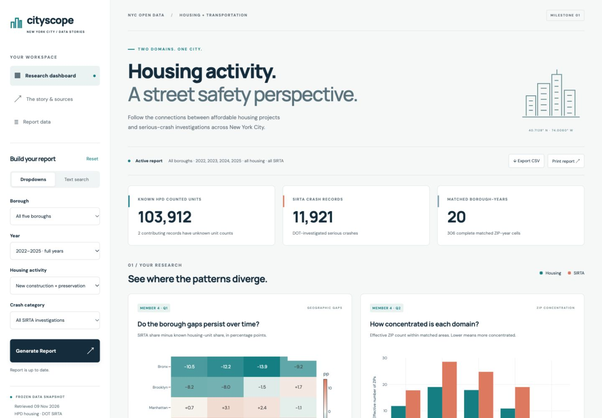

# Cityscope — NYC Housing & Street Safety

**Data Engineering and Visualization · Milestone 1 · Winter 2026**

Cityscope explores how affordable-housing activity and investigated serious-crash patterns vary across New York City. It combines NYC Open Data housing and transportation records, documents the cleaning and integration process, and presents the results through an interactive dashboard.

**[Open the dashboard](https://cityscope-nyc-housing.vercel.app/) · [Browse the repository](https://github.com/Pra1m3/nyc-housing-repo-milestone1)**



## Project overview

The project follows a data engineering workflow: source selection, exploratory analysis, pre-integration cleaning, aggregation, integration, post-integration validation and visualization. Its central question is whether the geography and timing of housing activity align with the patterns recorded in serious-crash investigations.

The dashboard provides:

- Borough, year, housing-activity and crash-category dropdowns.
- Text search that translates queries into filters.
- A central **Generate Report** button that updates all six charts, summary figures, findings and the evidence table.
- Interactive heatmaps, grouped bars, scatter plots and indexed time-series panels, with hover, zoom, pan and image export.
- CSV export, a printable report, source links and explanations of the findings and limitations.
- A responsive layout for desktop and mobile.

Example searches include `Brooklyn 2022 new buildings`, `Queens 2023-2025 preservation fatal crashes` and `Bronx 2024 nonfatal`. Filter changes take effect when **Generate Report** is selected; **Reset** restores the default view.

## Datasets

| Domain | Dataset | NYC Open Data ID | Raw records | Columns |
|---|---|---|---:|---:|
| Housing | [Affordable Housing Production by Building](https://data.cityofnewyork.us/d/hg8x-zxpr) | `hg8x-zxpr` | 9,551 | 41 |
| Transportation | [Serious Injury Response, Tracking & Analysis Program (SIRTA)](https://data.cityofnewyork.us/d/xeqp-qz8h) | `xeqp-qz8h` | 13,754 | 23 |

Both datasets appear in the project catalog, satisfy the nine-column minimum and were downloaded in full. The analysis uses frozen snapshots retrieved on **9 November 2026**. Source metadata, retrieval details and checksums are included in the repository.

Housing records include both new construction and preservation associated with project starts. SIRTA contains serious crashes investigated by NYC DOT; it does not represent every NYC crash or measure transit access.

## Cleaning and integration

Dates, borough names, geographic identifiers and categories are standardized before aggregation. Exact duplicates are removed; conflicting collision records and records without usable crash dates are quarantined. Missing unit values remain unknown, and plausible large buildings or multi-injury events are retained with outlier flags.

The primary integration key is **borough × calendar year**. Housing uses project-start year; transportation uses crash year. Each source is aggregated before a validated one-to-one join, avoiding multiplication of unrelated project and crash records. Post-integration cleaning preserves missing joined measures, reconciles geographic columns and aligns data types.

The default comparison covers the common full years **2022–2025**, with:

- **20** matched borough-year cells.
- **103,912** known HPD counted units; two contributing records have unknown counted-unit values.
- **11,921** borough-located SIRTA records.

The secondary ZIP analysis uses **2023–2025** and **306 complete matched ZIP-year cells** after geography and missing-value exclusions. The dashboard retains 2026 as an explicitly partial view through June 30; it is excluded from the default full-year comparison.

Category filters apply independently to each domain before reaggregation. They do not establish links between individual housing buildings and crash events.

## Research questions and findings

| Assigned member | Research question | Visualization |
|---|---|---|
| 2 | How do borough shares of known housing units compare with shares of SIRTA records? | Grouped bar chart |
| 2 | Does housing composition align with recorded severe injuries and fatalities per SIRTA record? | Bubble scatter plot |
| 3 | Do housing and investigated-crash activity follow similar trajectories across boroughs? | Indexed time-series panels |
| 3 | Are larger housing-unit counts associated with more SIRTA records within matched ZIP-years? | Log-scale scatter plot |
| 4 | Do borough-level housing/crash share gaps persist across years? | Heatmap |
| 4 | Is housing activity more geographically concentrated than SIRTA activity within matched ZIPs? | Effective-ZIP comparison |

Queens has a higher share of SIRTA records than known housing units in each full year, while the Bronx shows the reverse pattern. Within the complete matched ZIP subset, housing-unit activity is more concentrated than SIRTA records in all five boroughs. The pooled ZIP-level association between housing counts and SIRTA counts is weak and varies by borough.

These descriptive findings can guide coordinated HPD/DOT local review and further data collection. They do not establish causation or measure residents' crash risk.

**Research coverage:** the published dashboard currently contains the six views above. The four-member milestone requires eight research questions and charts; Member 1's two additional research views and the assembled Member 3 integration notebook still need to be added for full submission coverage.

## Repository structure

```text
.
├── README.md
├── vercel.json
├── notebooks/
│   ├── M1_Housing_Cleaning.ipynb
│   └── M4_Website_Research.ipynb
├── Member2_Transportation/
│   ├── notebooks/M2_Transportation.ipynb
│   ├── data/                  # Raw snapshots and processed tables
│   ├── charts/                # Research and exploratory figures
│   ├── reports/               # Findings, cleaning and validation evidence
│   ├── pipeline.py
│   └── reproduce.py
├── member4/
│   ├── research.py
│   ├── prepare_data.py
│   ├── reports/
│   └── DEPLOYMENT.md
└── website/
    ├── index.html
    ├── styles.css
    ├── app.js
    ├── core.js
    ├── report-session.js
    ├── data/nyc.json
    └── tests/
```

Start with the [housing notebook](notebooks/M1_Housing_Cleaning.ipynb), [transportation notebook](Member2_Transportation/notebooks/M2_Transportation.ipynb) and [website/research notebook](notebooks/M4_Website_Research.ipynb). Detailed cleaning and join decisions are documented in [the analysis review](Member2_Transportation/REVIEW_AND_DECISIONS.md).

## Run the dashboard locally

Requirements: **Node.js 20+** and **Python 3**. The browser app needs no npm dependency installation, API keys or database.

```bash
git clone https://github.com/Pra1m3/nyc-housing-repo-milestone1.git
cd nyc-housing-repo-milestone1/website
npm test
npm run build
python3 -m http.server 4173 --directory dist
```

Open **http://localhost:4173/**. Serve the app through HTTP rather than opening `index.html` directly, because it loads a local JSON file. Plotly.js 4.1.1 loads from the official CDN and requires internet access. The data snapshots are bundled, so the dashboard does not require live NYC API requests.

## Reproduce the analysis

From the repository root, create a Python environment and install the analysis dependencies:

```bash
python3 -m venv .venv
source .venv/bin/activate
python -m pip install -r Member2_Transportation/requirements.txt
python Member2_Transportation/reproduce.py
```

On Windows, activate the environment with `.venv\Scripts\activate`.

To regenerate the compact website data and Member 4 research figures from the included cleaned records:

```bash
python member4/prepare_data.py --member3 Member2_Transportation
python member4/research.py
cd website
npm test
npm run build
```

The `--member3` option names the shared integration input folder; `Member2_Transportation` contains the required processed tables in the current repository. To rerun notebooks interactively, install JupyterLab in the Python environment and open the notebook from the repository root or its notebook folder.

## Deployment

The website is hosted on **Vercel** at **https://cityscope-nyc-housing.vercel.app/**.

The root `vercel.json` defines:

| Setting | Value |
|---|---|
| Framework preset | Other |
| Build command | `cd website && npm run build` |
| Output directory | `website/dist` |
| Install command | `echo No runtime package installation required` |

To deploy manually, run `npx vercel link` from the repository root, select the `cityscope-nyc-housing` project, then run `npx vercel --prod`. Alternatively, connect the repository to Vercel using the settings above and select the intended production branch.

The deployed site was tested for public access, report generation, text search, reset, CSV export and responsive layout. The initial deployment used the local static build; automatic Git-based deployment should not be assumed unless the repository connection is configured. Deployment evidence is recorded in [the deployment guide](member4/DEPLOYMENT.md).

## Validation

The website has **10 automated tests**, including checks for search interpretation, independent category filtering, unknown-value preservation, report/export consistency and all 270 offered single-year dropdown combinations. Default totals and ZIP concentration results agree with the Python research calculations. Deployment checks compare the seven live assets against the local build by SHA-256.

See [website verification](member4/reports/VERIFICATION.md) and [analysis validation results](Member2_Transportation/reports/validation_results.json).

## Team contributions

| Member | Name | Student ID | Assigned responsibilities |
|---|---|---|---|
| 1 | Mohamed Walid | 16002100 | Housing dataset selection, exploration, cleaning and initial repository setup |
| 2 | Omar Aziz | 16007095 | Transportation exploration, cleaning, aggregation and two research questions/charts |
| 3 | Ahmad Salah | 16008995 | Integration strategy, post-integration cleaning, notebook coordination and two research questions/charts |
| 4 | Mohamed Khaled | 16003895 | Interactive website, filtering/search/report flow, deployment, documentation, two research questions/charts and submission email preparation |

The table records role allocation. Detailed contribution and AI-assistance records are retained in [the analysis contribution table](Member2_Transportation/CONTRIBUTIONS.csv), [Member 4's contribution table](member4/CONTRIBUTIONS.csv) and the corresponding [analysis](Member2_Transportation/PROMPTS_USED.md) and [website](member4/PROMPTS_USED.md) prompt logs.

## Limitations

- HPD project-start activity includes preservation and is not a measure of all newly occupied housing or the housing stock.
- SIRTA is a selected set of serious-crash investigations; reporting and investigation coverage may vary over time.
- ZIP completeness varies by source and year. Matched-only analysis excludes areas with unavailable or ambiguous geography.
- Counts are not adjusted for population, traffic exposure or ZIP size. Borough totals can hide local differences.
- Missing values are not treated as zero, and 2026 is partial. Associations are descriptive rather than causal.
